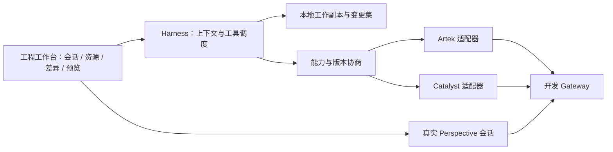

# 架构建议（待讨论，非已批准实现规格）

## 方案比较

| 方案 | 优点 | 代价 |
|---|---|---|
| DSH 插件 | 快速复用会话、模型与工具 UI | 专用编辑和预览布局受宿主扩展能力约束 |
| Fork DSH | 现成功能多，可深改 UI | 上游同步、体积与维护成本高 |
| 独立领域内核 + 专用工作台（建议） | 资源事务、版本适配、预览生命周期可独立设计 | 初期需要搭建基础会话界面 |

以上为研究建议，用户尚未选定实现路线。候选技术：TypeScript/Node.js 领域服务、React UI；桌面壳优先评估 Electron 的 Chromium 预览一致性，Tauri 作为体积更小的对照。实际选择由预览 spike 决定。

## 组件边界

模型端配置与 Gateway 凭据分离。MCP 客户端放在本地服务进程，浏览器 UI 不直接持有 Gateway token。预览会话使用用户自身登录，不把 MCP 凭据等同于 Perspective 会话凭据。

## 建议领域能力

以下为内部抽象名，不是已存在的供应商工具名：

- `discoverCapabilities`：记录 Gateway build、模块版本、工具 schema 指纹及权限。
- `listResources` / `readResource`：统一路径、资源类型、原始内容及内容 hash。
- `validateChangeSet`：结构校验、引用检查和平台验证结果分开呈现。
- `applyChangeSet`：写前重读基线、检测冲突，记录逐资源结果。
- `openPreview`：真实会话 URL、目标项目、已发布变更集、截图与日志关联。

只映射实际发现且已验证的工具。工具缺失时明确显示能力不可用，不悄悄改用任意脚本执行。支持列表通过实测维护，不用版本号推断全部功能。

## 修改闭环

读取资源快照 → 本地修改 → 展示差异 → 校验 → 开发 Gateway 写入 → 重读验证 → 打开真实会话 → 关联测试证据。

多资源变更不假定 Gateway 提供事务。优先采用开发项目隔离；写入中断时保留部分成功状态，并从原始快照尝试补偿，补偿也要验证。资源内容 hash 是客户端冲突检测手段；如果服务端没有原子条件写入，仍存在检查与写入间竞态，须显式标注，不能宣称强一致事务。

## 第一版范围

建议先做项目只读浏览、单个 Perspective View 修改、变更审查、开发 Gateway 发布及真实会话预览。生产发布、任意 Gateway 管理、Vision/Reporting 全覆盖和离线 Perspective 仿真均后置。

质量目标不是“生成了 JSON”，而是用户在同一工作台中完成一次可追溯的 View 修改，并看到对应版本在真实运行时中的结果。
