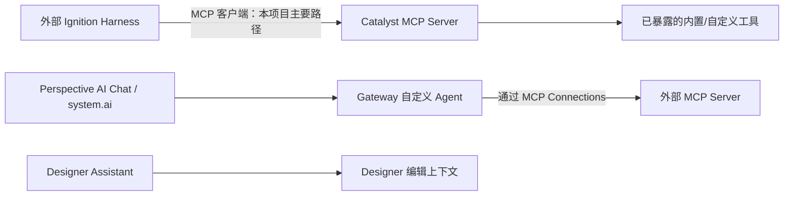

# Catalyst 专项调研：2027 Beta 接入与 Designer 替代边界

调研日期：2026-11-17。资料基线：官方手册标注的 **2027.02 Beta**，不等于本项目已安装或测试该 build。本文区分文档事实、技术推论和待验证事项。此前总览只提及 MCP 路径，未覆盖完整 Catalyst 产品面，本文件补齐该缺口。

## 1. 产品结构

| 部件 | 官方定位 | 对 Harness 的意义 |
|---|---|---|
| Catalyst Core | 平台随附；提供模型接入、Designer/Gateway AI 辅助与会话监控 | 现有内置 AI 开发体验，也是潜在集成基础 |
| Catalyst Agent | 自定义 Agent、MCP 服务端/客户端、脚本入口与 Perspective Chat | 对外 Harness 的主要协议接入层 |

官方列出 Core 支持 Standard、Cloud、Maker、Edge，Agent 支持 Standard、Cloud、Maker；不能给 Edge 用户承诺相同的 Agent/MCP 路线。随附 Core 不代表 Agent 商业许可也已包含。当前资料不足以确定正式价格和最终授权条款，应单独核实。[C1]

Core 支持 Anthropic、Ollama、OpenAI/兼容接口、OpenRouter。Agent 依赖 Core，文档要求配置模型提供者。Core 还提供诊断模型选择及活跃/近期 AI 会话信息。**建议**外部 Harness 自行管理 agent loop；Gateway 的模型配置先按官方前提完成，再实测纯 MCP 调用是否触发模型请求，不预设双重推理费用。[C2][C3]

## 2. 三种连接方向必须分开

MCP Server 使用 Streamable HTTP；在 Services > Catalyst > MCP Servers 建立，选择 Configure Primitives 后复制实际 Endpoint URL。MCP Connections 是出站客户端，不是给 Harness 连接的服务地址。Server 与 Gateway Agent 可以独立工作。

官方明确有 `ignition` 分组的内置工具；但已查页面没有逐项公开工具名称、参数和项目写入语义。故当前结论是“有内置工具”，不能升级为“完整远程 Designer API”。[C3]

## 3. Designer Assistant 与外部 MCP 的差距

官方 Designer 文档列出脚本、Named Query、UDT 等 AI 辅助入口，生成结果由用户应用后才生效；还支持在 Designer 创建带参数、描述、权限的脚本工具。[C4]

IA 工程师在开发者论坛解释：组件助手读取组件 schema，表达式/脚本函数可经工具查询，第三方工作区可通过 AiContext 集成；绑定等扩展可采用 schema。其示例把模型建议交回编辑器验证并写回，且明确提示接口仍可能变化。[C5]

**技术推论**：组件 schema、选中对象、编辑器状态和 Apply 行为是 Designer 宿主上下文的一部分，不能仅凭相同工具名称假定 Gateway MCP 也具有这些上下文。要替代 Designer，需要验证：

| 能力 | 公开资料能确认什么 | 本项目仍缺什么 |
|---|---|---|
| 组件/绑定辅助 | Designer 内部存在上下文集成 | 是否能远程取得当前模块对应的完整 schema |
| 项目理解 | 可建立脚本工具，MCP 有内置工具 | 资源枚举、继承解析和无损读取的实际 schema |
| View 编辑 | Designer 能辅助工程工作 | 外部写入工具、元数据保存、重载与冲突语义 |
| 应用修改 | Designer 中存在用户 Apply 流程 | 外部工作副本、差异、校验和发布闭环 |
| 第三方组件 | 论坛描述组件 schema 集成机制 | 每个模块/build 的可访问性和兼容验证 |

这些是验证任务，不是已证实缺失的官方功能。若内置 MCP 工具足够，优先直接映射；不足时再评估范围明确的自定义工具或 Gateway API。依赖 Designer SDK 的扩展仍要求运行 Designer，与最终完全替代入口的目标存在取舍。

## 4. 认证与授权

Gateway API 文档规定 REST 请求使用 `X-Ignition-API-Token`，API Key 可附加安全级别且默认要求安全连接。[C6][C7] Catalyst Server 文档也描述 API token 与 Server/Tool 权限，但本文**不把 REST 的 header 约定当成已实测的 MCP 认证结论**。[C3]

首轮需要验证相同 token 在 MCP 端的实际 header、401/403 行为、安全级别传递与工具级拒绝。MCP Connections 文档中的 Authorization/Bearer 设置描述的是出站连接，不能直接照搬到入站 Catalyst Server。不要因 MCP 服务设为 Public 就理解为无凭据访问。

Perspective 登录身份与 MCP 凭据应分别管理；浏览器预览不继承“API 已认证”的结论。**建议**在 Harness 中分别呈现连接身份、工具权限与预览登录状态。

## 5. Perspective 与脚本集成

AI Chat 是绑定 Gateway Agent 的运行时组件，可注入页面上下文并显示 token 用量；它不是用于生成整个项目的替代 Designer。[C8] 组件自己的 Agent Tools 与 Gateway 工具作用域不同；`receivedResponse` 可携带本轮工具调用记录，但失败/取消等情况不触发该事件。[C9]

`system.ai.sendMessage` 是调用用户 Agent 并返回最终文本的脚本函数，不是公开的外部流式会话 API。当前文档还说明 `timeoutSecs` 暂未强制执行，且其 Gateway 脚本示例对系统调用者权限的描述，与 Agent 页面关于自主调用者的描述需交叉实测。[C10][C3]

**建议**：主产品先用外部 Harness → MCP Server 的确定性工具调用；把 Gateway Agent 和 AI Chat 作为未来运行时助手集成方向。不得把自然语言最终回复作为项目已成功发布的唯一证据。真实 Perspective 会话继续承担预览和运行验收。

## 6. 版本与替代连接路径

2027 升级指南明确 8.x 模块须针对 2027 重新构建；旧模块不能直接作为兼容备用方案。指南还说明 Beta 的许可限制、默认设置变化，并要求 Beta 用于开发/测试系统。[C11]

Gateway 暴露 `/openapi` 和 `/openapi.json`，内容依据实际 Gateway 与安装模块生成。[C7] **建议**把 REST 作为候选资源适配层调查：从实际 spec 选出项目资源读写 API，确认后才调用。不能由“配置资源 API 存在”推定“任意 Perspective View 都能读写”，也不在本文编造 endpoint。

## 7. Catalyst 专项验证清单

尚未执行。每项都要记录 Gateway 完整 build、Core/Agent 模块版本、edition、许可和项目继承关系。

| 编号 | 验证方法 | 通过标准/交付证据 |
|---|---|---|
| CAT-01 | 按官方依赖安装；分别验证启用、停用、无 provider | 记录实际前提和可用功能，不静默忽略依赖 |
| CAT-02 | 用复制的 URL initialize、分页 tools/list | 脱敏工具清单与 schema；标记来源和权限 |
| CAT-03 | 对比未授权、token、不同安全级别及工具权限 | 记录 header 和实际授权行为，确认拒绝不会产生写入 |
| CAT-04 | 在配置允许范围内检查纯 MCP 调用是否使用 Gateway 模型 | 分清工具服务和 Gateway agent 的推理边界 |
| CAT-05 | 枚举/读取测试 View、Style、脚本和继承资源 | 无损往返快照；未知字段保持 |
| CAT-06 | 修改一个 View，写入、重读、真实预览、恢复 | 前后 hash、结果、截图一致；判定是否能关闭 Designer 操作 |
| CAT-07 | Designer 同时编辑、写入中断及模块停用 | 不误报成功；保留冲突或部分失败证据 |
| CAT-08 | 会话过期、断线和工具 schema 改变 | 可重新协商；不自动重放状态未知的写操作 |
| CAT-09 | 内置能力不足时检查实际 openapi.json | 列出可用替代 API 及其范围，不能猜测 URL |
| CAT-10 | 第三方组件/绑定及 AI Chat/脚本权限对照 | 明确宿主作用域、支持范围与文档矛盾的实测结果 |

研究阶段退出条件：先得到真实工具清单，并证明 CAT-06 的单 View 闭环。若只能读取 OT 数据，就应明确结论“当前连接尚不足以替代 Designer”，再选择补充服务端工具或缩小 MVP；不继续堆叠 UI 掩盖连接能力缺口。

## 来源索引

以下均为 IA 官方手册或官方开发者论坛的一手资料；论坛技术讨论不作为稳定 SDK 合同。

- [C1 Catalyst 总览](https://docs.inductiveautomation.com/docs/2027/ignition-modules/catalyst)
- [C2 Catalyst Core](https://docs.inductiveautomation.com/docs/2027/ignition-modules/catalyst/catalyst-core)
- [C3 Catalyst Agent](https://docs.inductiveautomation.com/docs/2027/ignition-modules/catalyst/catalyst-agent)
- [C4 Catalyst Designer Interface](https://docs.inductiveautomation.com/docs/2027/ignition-modules/catalyst/catalyst-designer-interface)
- [C5 Catalyst + 3rd Party Modules](https://forum.inductiveautomation.com/t/catalyst-3rd-party-modules/117292) — 2026-10-01 技术讨论。
- [C6 API Keys](https://docs.inductiveautomation.com/docs/2027/platform/security/api-keys)
- [C7 API Documentation](https://docs.inductiveautomation.com/docs/2027/platform/gateway/openapi)
- [C8 Perspective AI Chat](https://docs.inductiveautomation.com/docs/2027/appendix/components/perspective-components/perspective-embedded-palette/perspective-ai-chat)
- [C9 AI Chat Scripting](https://docs.inductiveautomation.com/docs/2027/appendix/components/perspective-components/perspective-embedded-palette/perspective-ai-chat/perspective-ai-chat-scripting)
- [C10 system.ai.sendMessage](https://docs.inductiveautomation.com/docs/2027/appendix/scripting-functions/system-ai/system-ai-sendMessage)
- [C11 8.3 → 2027 升级指南](https://docs.inductiveautomation.com/docs/2027/getting-started/installing-and-upgrading/ignition-8-upgrade-guide/83to2027-upgrade-guide)
