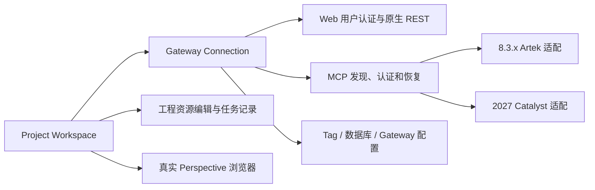

# 基于两套真实 Gateway 的实现路线

日期：2026-11-17。此文是研究后的实现建议，尚未实现桌面产品。依据：[用户范围](product-requirements.md)、[Beta 实测](runtime-validation-2027-beta1.md)、[8.3.9 实测](runtime-validation-8.3.9.md)、[固定版本代码/SDK 调查](technical-investigation.md)。

## 产品结构

工作台采用用户要求的左侧 Projects、中央聊天/编辑区、右侧或标签页中的真实 Perspective 预览。Tag 树、数据库和 Gateway 配置是可切换面板；操作结果进入同一任务记录。

Project 项至少保存 Gateway 引用、项目名、工程身份引用、预览位置、最近活动。Gateway 则独立保存 Tag Provider、数据库与配置状态，避免切换项目后把共享资源误判为该项目私有。

建议连接模型：

复用 DSH 的 Electron 工作区、Agent 调度和浏览器管理更接近目标。其固定 commit 中浏览器临时 partition 的行为必须修改；不能直接沿用后宣称登录可跨应用重启保持。此处是技术建议，不表示已创建 DSH fork 或完成桌面选型批准。

## 连接不是一个 session 字段

| 状态 | 恢复方式 | 实测/限制 |
|---|---|---|
| Gateway 用户认证 | 交互 IdP；独立持久浏览器 profile；检查 session 有效性 | Beta 重开浏览器可恢复；Gateway 重启后旧 session 401 |
| 原生写入 | 有效用户 cookie + X-CSRF-Token，或目标允许的 API 身份 | 两版本均完成用户会话下写入 |
| Catalyst MCP | 独立 API token，初始化和 MCP session | Cookie 初始化 403；过期 session 404 后可重新初始化 |
| Artek MCP | 按供应商合同和实际发现结果实现 | 文档称 stateless；尚未拿到模块运行验证 |
| Perspective 预览 | 真实 Gateway runtime 的独立运行身份/权限 | 当前实验使用开放测试项目；不推断等同工程管理员身份 |

长期连接实现为明确状态：connecting → ready → reconnecting，认证失效进入 authentication-required；网络错误采用有界退避。MCP 过期不立即等同用户密码失效。UI 应显示当前 Gateway、项目、用户及各通道状态。

浏览器 profile 至少按 Gateway 与用户隔离，不只按 hostname 或项目名分区。持久 API secret 放 OS credential store，Project 配置仅存引用；不能把 Web cookie、管理员 API key 与项目元数据一起写入 Git。此设计来自用户的持久登录与身份隔离要求，企业 IdP/MFA 的兼容性仍需实测。

## 领域适配与实际能力选择

启动时读取版本/build、已安装模块和动态 OpenAPI，再初始化 MCP、分页 tools/list。按真实路径/schema 建立能力表，不按版本号硬编码“必然拥有全部功能”。当前两套实验中 OpenAPI 分别为 389/455 条路径，模块安装变化也会影响数量。

| 领域 | 已验证路线 | 必须补齐 |
|---|---|---|
| 项目创建与读取 | 两版本原生 projects API 和 ZIP export | 继承定义方、低权限角色和大型项目 |
| View/项目库脚本 | 保留原生元数据，修改自有项目 ZIP 再 import；真实预览验收 | 资源级原子签名提交、多人同时编辑 |
| Gateway Startup | 独立 ignition/startup + onStartup.py；两版本日志证明执行 | Timer、Tag Change、Message Handler 等独立宿主 |
| Perspective 组件事件 | View JSON 内 onActionPerformed；两版本点击后脚本写 Tag 成功 | 其他事件和第三方组件 schema |
| Tag 配置 | 8.3.9 import/export；Beta configuration REST | UDT 默认值/覆盖与继承、批量部分失败 |
| Tag 实时值 | Beta MCP realtime 或原生 read/write | Artek 实测；外部 Tag 推送订阅和树结构通知 |
| Gateway 配置 | schema/读取/资源 signature PUT，读回 health | 更多配置类型、secret 保留和需重启项 |
| 数据库 | 原生连接配置 + 项目脚本查询 + 真实 Table 周期刷新 | 独立 DB inspector 的表结构/分页 RPC、Named Query |

8.3.9 Memory Tag 配置导入导致值更新，并不取代运行值写入适配。两版本配置签名冲突 HTTP 状态不同，需识别经过验证的响应；未知 500 不自动重试。项目 import 与配置 signature PUT 也不是同一并发合同。

MCP 工具应映射到领域操作（例如 tag.readValues、project.readResource），不要让 UI 直接依赖 wire tool 名称。Catalyst 当前内置工具集只有查询/诊断，写入经已验证 REST 或限定扩展完成。自定义 Catalyst 工具的项目资源格式、调用方权限和外部调用仍需专门实验，不能因为文档说可以在 Designer 创建就算完成无 Designer 部署。

## 第一条完整产品链路

首个实现应让用户完成以下连续操作，全部连接真实 Gateway：

1. 添加 Gateway，完成交互登录，选择并添加 Project；关闭/重开工作台后恢复，再处理一次服务端 session 失效。
2. 在 Tag 面板创建自有 Memory Tag，编辑配置；在支持的实时通道中读取和写值，显示逐项质量码。
3. 在聊天任务中生成 View 与项目库脚本，先展示可检查的变更，再通过已实现的提交路径写回；冲突时重新读取和合并。
4. 内置 Perspective 维持当前页面，显示新标题、绑定值和脚本结果。提交接受与运行验证分别记录；首轮数据库延迟现象证明两者必须区分。
5. 修改一项 Gateway 配置，读回 signature 和健康状态；打开数据库查询结果并验证刷新。
6. 断开再恢复连接，确认不会重复执行已完成的写入。

这里的“展示变更”属于产品编辑体验，不能解读为每次实验都必须额外向用户索要权限。

## 后续验证顺序与阻塞

- **模块依赖阻塞**：Artek 官网下载会提交个人资料；当前未取得 modl，也没有已安装模块的测试 Gateway。先补实际工具/模式/认证合同，再声称支持该组合。
- **正确性优先**：项目资源级并发更新与继承归属。即便 ZIP 热更新已成功，仍不能将其冒充 Designer 的编辑锁和增量保存语义。
- **补充能力**：外部数据库 schema/分页调用；Catalyst 自定义工具的无 Designer 部署；Tag 订阅与结构变化；剩余事件宿主。
- **身份矩阵**：默认 IdP 以外的企业登录、MFA、Designer-only 与只读/工程/管理员角色分离。
- **然后实施桌面壳**：按上述真实链路验收，最终保留 Gateway Web 配置页面入口，以覆盖尚未做原生表单的配置类型。

本轮交付是两版本运行证据、研究探针和可复跑文本夹具。它足以把下一步开发建立在真实接口上，但还不构成可安装的 Ignition Harness。
