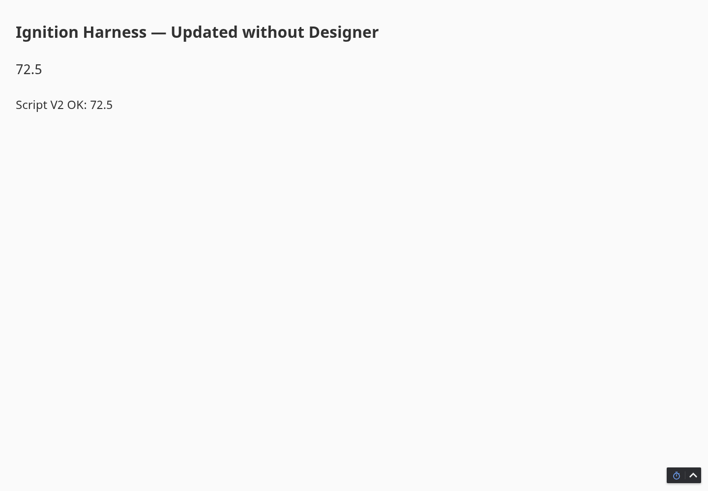
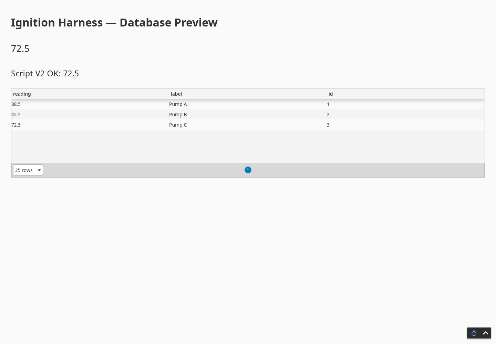

# 2027.2.0-beta1：实际 Gateway 验证结果

日期：2026-11-17。此文补齐此前只有静态 SDK 调查的缺口。对象为 **Ignition Standard 2027.2.0-beta1 (b2026110221)**，安装了同 build 的 Catalyst Core、Catalyst Agent、Perspective、WebDev；未配置任何模型提供者，未打开 Designer。

本轮使用真实 Gateway、真实 HTTP/MCP 调用与 Chromium 156 的真实 Perspective 会话。截图是测试项目的运行结果，**不是已经完成的 Harness 产品界面**。

## 结论先行

**完整工作台可行，但不能把 Catalyst MCP 当成完整工程 API。** 本环境的内置 MCP 工具提供 Tag 查询与诊断；新建 Tag、修改配置、导入 View/脚本及 Gateway 配置可以通过原生 REST 完成。Web 登录与 MCP 的凭据需要分开管理；Perspective 运行身份也是独立状态。

此前“所有 Catalyst 功能都需要先配置 Gateway 模型提供者”的宽泛前提，不适用于本轮验证的纯 MCP 工具服务。零模型提供者下，四项内置工具均成功调用。没有测试 Gateway 内部 Agent 推理功能，不能把这个结果延伸到它。

## 已执行的场景

| 场景 | 实际结果 | 证据 |
|---|---|---|
| 交互登录 | 默认 IdP 经用户名、密码两步登录成功 | [认证摘要](evidence/runtime-beta1/environment-and-auth.json) |
| 浏览器重开 | 持久 Chromium profile 重开后 Web session 仍返回 200 | 同上；不是 DSH 当前临时 partition 的行为承诺 |
| Gateway 重启 | cookie 保留，但旧 Web session 返回 401，重新登录后恢复 | 同上 |
| 未认证读 OpenAPI | 403 | 同上 |
| Web 会话读 OpenAPI | 200，动态 spec 共 455 条路径 | 同上 |
| Web 会话缺少 CSRF 的 POST | 403；正确 CSRF 后合法操作成功 | [Tag 测试](evidence/runtime-beta1/tag-runtime-results.json) |
| 新建 Memory Tag | 新建 `[default]HarnessLab/Temperature` 成功 | 同上 |
| 修改 Tag 配置和值 | `engUnit=C`，写入/读回 42.5，质量码 192 | 同上 |
| MCP 初始化 | 无凭据和仅 Web cookie 均 403；API token 成功 | [协议发现](evidence/runtime-beta1/mcp-api-token.json) |
| MCP 四项工具调用 | `providers/query/realtime/diagnostics` 均 `isError=false` | [调用结果](evidence/runtime-beta1/mcp-call-results.json) |
| DSH 使用的 Node 客户端版本 | `@modelcontextprotocol/client@2.2.0` 连接、发现和读值成功，无诊断错误 | [SDK 结果](evidence/runtime-beta1/node-sdk-results.json) |
| MCP 会话失效与恢复 | 寿命设为 1 分钟，66 秒后 404；原 API token 重新初始化成功 | [过期实验](evidence/runtime-beta1/session-expiry-results.json) |
| 项目直接导入 | 经 REST 创建项目并导入 View、脚本，无 Designer 保存步骤 | [实时预览结果](evidence/runtime-beta1/live-preview-results.json) |
| 现有预览收到更新 | Tag 值、View 标题、项目库脚本更新均生效；主页面导航次数仍为 1 | 同上 |
| Gateway 配置修改 | SQLite 连接池配置从 8 改为 4，连接恢复为 Valid | [配置实验](evidence/runtime-beta1/config-conflict-results.json) |
| 过期签名提交 | 409，旧请求没有把连接池改为 6，读回仍为 4 | 同上 |
| 数据库运行访问 | Gateway 项目脚本从独立 SQLite 测试库读出三行 | [数据库预览](evidence/runtime-beta1/database-preview-results.json) |
| 数据库预览刷新 | 外部测试夹具把一行改为 88.5，2 秒周期查询使现有页面更新，无刷新导航 | 同上；不是数据库推送订阅 |

## 认证、会话和长期连接

### 实测的身份边界

- Gateway 管理 REST：Web session cookie + `X-CSRF-Token` 能完成用户身份下的写入。资源修改记录中的 actor 为该登录用户。
- Catalyst MCP：本环境验证使用 `X-Ignition-API-Token`，值格式为 `<keyName>:<secret>`。Web cookie 不被该 MCP endpoint 接受。
- MCP 返回独立 `Mcp-Session-Id`。会话过期后，在 API token 仍有效的前提下重新初始化即可，不应把一次 404 立即变成要求用户重新输入密码。
- Gateway 重启导致 Web session 失效时，则需要重建用户认证。客户端保留 cookie 不能替代服务端的有效性判断。

测试 API key 为隔离 HTTP 实验显式关闭了 `secureChannelRequired`；这是本地实验设置，不是产品生产默认。API token、登录密码、CSRF token、cookie 和实际 MCP session ID 均未提交。

### 对 Project 栏的影响

Project Workspace 应引用 Gateway 和工程身份，而不是仅保存项目名。需要分别呈现用户认证、MCP transport、实时数据显示和 Perspective 登录状态。相同身份可以复用连接，但不同 Gateway、不同用户的浏览器 profile 和凭据不能混用。

当前只验证默认 IdP；尚未覆盖企业 SAML/OIDC、MFA、Designer-only 用户与低权限角色的完整矩阵。

## Catalyst MCP 的真实工具合同

从 UI 的 Copy Endpoint URL 获取到本实验地址：

`http://127.0.0.1:18088/data/catalyst-agent/mcp-servers/HarnessLab`

协商协议为 `2025-06-18`。当前工具在 wire 层的名字直接为 `diagnostics`、`realtime`、`query`、`providers`，不是从 UI 分组名猜出的名称。

- `realtime`：必填 `paths` 数组；返回值、质量码、时间戳和 `valueType`。
- `query`：必填 `path`；可带 filters 和 continuationPoint；返回 `tagKind/dataType`，可分页。
- `providers`：无参数。
- `diagnostics`：必填 `path`。

完整输入 schema 保存在 [实际发现结果](evidence/runtime-beta1/mcp-api-token.json)。这是当前安装和选择的 provider/tool 集合，不承诺别的模块或未来版本仍只有四项。工具名称、权限和 schema 都应从协商结果读取。

已用 DSH 固定 commit 所依赖的同版 Node 客户端验证，避免“手写 HTTP 能通”就宣称 DSH 一定兼容。手工 GET transport 探测曾收到 415；本轮不据此判定缺少 SSE，因为标准 Node 客户端的完整只读调用流程实际成功。

## 已确认的原生 REST 路线

这些路径来自本次运行 Gateway 的 OpenAPI，随后执行了相关操作：

| 路径 | 用途与重要限制 |
|---|---|
| `/openapi.json` | 获取实际安装模块的 API 合同；本轮接受有效 Web session |
| `/data/api/v1/tags/configuration` GET/POST | Tag 配置读取、创建和修改；检查逐项失败数 |
| `/data/api/v1/tags/read` GET | schema 要求 JSON 请求体；浏览器 Fetch 不允许 GET body，客户端传输层需要处理这个差异，或使用 MCP realtime |
| `/data/api/v1/tags/write` POST | 值写入；逐项质量码是结果依据 |
| `/data/api/v1/projects` POST | 创建项目 |
| `/data/api/v1/projects/export/{name}` GET | 导出 ZIP，保留原始元数据与未知文件 |
| `/data/api/v1/projects/import/{name}` POST | ZIP 导入；`overwrite=true` 用于本实验唯一自有项目 |
| `/data/api/v1/resources/ignition/database-connection` POST/PUT | 创建及修改 Gateway 数据库连接；PUT 使用资源 signature |
| `/data/api/v1/resources/com.inductiveautomation.catalyst.agent/mcp-server-host` POST/PUT | 配置入站 MCP Server，包含工具选择、权限与 sessionManagement |

**仍不能把项目 ZIP 覆盖宣称为安全的资源级并发编辑 API。** 本轮在自有测试项目上证明了可写入和热更新；没有证明项目 import 支持所需的原子签名比较。配置资源 PUT 的 409 也不能自动推定为项目 import 的同一合同。多人编辑是否需要小型 companion，仍应围绕这个缺口决定，而非因为“没找到 REST”就直接加模块。

## 真实画面与脚本的验证方式

测试项目包含一个 View、一份 page-config 和一个项目库模块 `lab_helpers`。原生导出的 `project.json/global-props` 原样保留，新增资源按公开 SDK 示例的资源描述格式构建，通过项目 import API 写回。

View 的一个 Label 直接绑定 Memory Tag，另一个通过脚本 transform 调用项目库函数。V1 显示 `Script OK: 42.5`；更新 View 和模块后，现有会话显示 `Script V2 OK: 72.5`。没有打开 Designer，也没有 reload 主页面。



数据库实验用原生 SQLite JDBC 连接，项目脚本查询表并返回 Table 数据。修改测试库后，现有页面显示新值 88.5：



这证明 Gateway 数据库连接、项目脚本查询与运行时显示可用；**尚未证明有一个面向外部工作台的通用 SQL/表结构浏览 RPC**。独立 DB inspector 仍需确认公开接口，或提供明确范围的自定义工具/bridge。也未验证 Gateway 事件脚本、组件事件脚本等全部宿主格式。

## 环境限制与复跑

Docker 使用 vfs 存储，完整镜像下载后在层注册时 ENOSPC。没有重启或改配置 Docker daemon。随后直接下载官方 OCI 应用层，验证字节数与 SHA-256，再将 Linux 安装文件解到独立目录运行；未安装系统服务。跳过了 macOS runtime 和镜像中指向 stdout 的日志链接。实验只用模拟 Tag 和独立 SQLite 文件。

只读 MCP 探测可复跑：

```bash
python research/probe_mcp.py \
  --url 'http://127.0.0.1:18088/data/catalyst-agent/mcp-servers/HarnessLab' \
  --headers-file /path/outside/repository/private-headers.json \
  --output /path/to/discovered-tools.json
```

headers 文件只存于本机私有位置，不提交。本轮仍未实现桌面产品。[8.3.9 原生能力已另行实测](runtime-validation-8.3.9.md)，Artek 模块运行兼容仍待验证。下一步应以已验证的原生能力设计领域适配层，补做权限、继承、并发写入和跨版本验证，而不是继续重复手册总览。

## 补测：Gateway Startup 与 Perspective 组件事件

通过项目 ZIP 增加 `ignition/startup/resource.json` 和 `onStartup.py`，`scope=G`、`attributes.enabled=true`。资源类型、文件名和函数前导由 Beta SDK 的公开 `ScriptConfig.StartupScript.serialize` 确认：`ignition/startup`、`onStartup.py`、`def onStartup():`，脚本体保留函数缩进。实际导入后，Gateway 日志出现 `HARNESS_LAB_STARTUP_V1_VERIFIED`，见[执行记录](evidence/runtime-beta1/startup-execution.json)。

随后在 View 中添加按钮的 `component.onActionPerformed` 脚本。真实浏览器点击后，`system.tag.writeBlocking` 将实验 Memory Tag 写为 91.5，按钮显示 `Event OK: Good`，绑定的项目库脚本 Label 显示 `Script V2 OK: 91.5`，主页面导航次数仍为 1，见[事件结果](evidence/runtime-beta1/component-event-results.json)。该调用发生在 Perspective 事件脚本中，不是新发现的外部 Tag RPC。

测试新增的文本资源见[复跑夹具](../research/fixtures/README.md)。这次覆盖了项目库、Gateway Startup 和组件事件；Timer、Tag Change、Message Handler、Perspective Session/Page 事件等仍未逐项验证，不能一概标为已支持。
