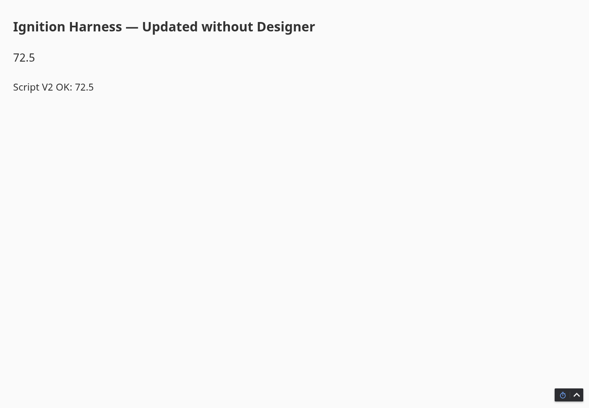
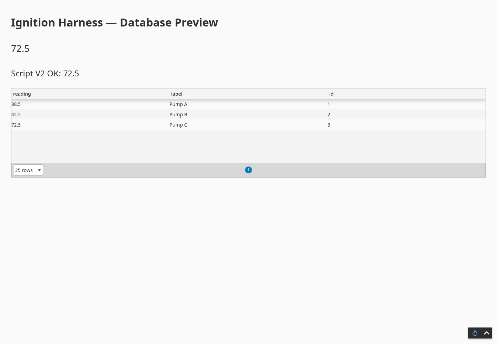

# Ignition 8.3.9：真实 Gateway 验证与 Beta 差异

日期：2026-11-17。运行对象为官方镜像 `inductiveautomation/ignition:8.3.9` 的 Linux 安装文件，build `b2026082511`，Java 17.0.19。已加载 Perspective 3.3.9 和 WebDev 6.3.9；**尚未取得、安装或运行 Artek-MCP**。与 [2027.2.0-beta1 实验](runtime-validation-2027-beta1.md) 使用不同端口、用户凭据和 Chromium profile，未打开 Designer。

官方 OCI 应用层完整字节与 SHA-256 校验通过，摘要见[环境记录](evidence/runtime-8.3.9/environment-and-auth.json)。安装文件解到独立目录运行，不安装系统服务。

## 已跑通的能力

| 场景 | 8.3.9 实测结果 | 证据 |
|---|---|---|
| 默认 IdP 交互登录 | Web session 200，认证后 OpenAPI 200；匿名分别 401/403 | [环境记录](evidence/runtime-8.3.9/environment-and-auth.json) |
| 动态 OpenAPI | 当前安装环境共 389 条路径；Beta 为 455 | [接口比较](evidence/runtime-8.3.9/contract-comparison.json) |
| 新建 Tag | Tag import 新建 Folder + Float8 Memory Tag，failureCount=0 | [导入结果](evidence/runtime-8.3.9/tag-import-results.json) |
| 修改 Tag 配置 | MergeOverwrite 将 engUnit 改为 C，export 读回正确 | 同上 |
| 项目创建及导出/导入 | 创建 HarnessLab，保留原始 global-props，添加 View/page-config/项目库脚本 | [创建](evidence/runtime-8.3.9/project-create-result.json)、[导入](evidence/runtime-8.3.9/project-import-result.json) |
| 真实 Perspective 热更新 | 同一页面看到 View 标题、脚本 V2 及值 72.5；主页面导航次数 1 | [热更新结果](evidence/runtime-8.3.9/live-preview-results.json) |
| Gateway 数据库配置 | 创建 SQLite 连接，Valid；连接池由 8 改为 4 | [配置结果](evidence/runtime-8.3.9/config-conflict-results.json) |
| 配置过期签名 | 返回 500 + signature mismatch；success=false；读回仍为 4 | 同上 |
| 数据库运行预览 | 项目脚本查询三行，外部夹具改为 88.5 后当前页面更新；导航次数 1 | [预览结果](evidence/runtime-8.3.9/database-preview-results.json) |

## 必须处理的版本差异

### Tag API 不能照搬

Beta 中已验证的 `/data/api/v1/tags/configuration`、`/tags/read`、`/tags/write` 在此 8.3.9 安装环境的 OpenAPI 中不存在，实际请求也均返回 404，见[失败记录](evidence/runtime-8.3.9/tag-results.json)。

8.3.9 可用并已执行的是：

- `POST /data/api/v1/tags/import?provider=default&type=json&collisionPolicy=Abort`：body 为 Tag JSON 文件的原始字节，Content-Type 为 application/octet-stream。
- 同一 endpoint 采用 `MergeOverwrite`、父路径 `path=HarnessLab` 修改指定子 Tag 的配置。
- `GET /data/api/v1/tags/export?provider=default&type=json&path=HarnessLab`：返回配置 JSON。

本实验通过导入 Memory Tag 的 value，使运行页面依次看到 42.5、61.5 和 72.5。**这是配置导入路径，不能包装成已验证的通用运行值写入 API**；它可能同时影响默认值。Artek `tag_read/tag_write` 的运行行为仍需模块实测。export 可证明配置可读，但尚未证明它适合作为大型 Tag 树的分页浏览或高频实时读取通道。

还发现此版本 OpenAPI 对 import 的 200 body 描述为数组，但实际成功响应是 `successCount/failureCount/failures` 对象。适配器必须处理真实合同差异，不能仅靠静态 schema 生成后即宣称可用。

### 冲突不总是 HTTP 409

相同的 Gateway 配置过期签名实验，Beta 返回 409，8.3.9 返回 500，body 明确 `success=false` 且包含 `signature mismatch`。两个版本均没有把旧提交的连接池值 6 应用到服务器。

产品需要将已识别的版本/响应归一为“资源冲突”，提示重新读取和合并。未知 500 保留原始失败信息；不能全部归为冲突，也不能自动重试写入。

### 导入成功不等于运行时立即稳定

数据库预览首轮等候 20 秒未显示 Pump A，虽然项目导入成功且数据库连接为 Valid。随后再次检查时，同一导出资源包含预期脚本，画面显示了三行；再跑更新实验通过。未重新配置连接或重新导入项目来解决这个问题，根因尚未定位。

首轮失败保留于环境记录。这个现象要求产品区分“提交已接受”和“运行时已验证”，使用明确的可观察条件与超时状态；不能只根据 import 返回 200 显示整个任务成功。

## Artek 验证的具体阻塞

供应商 [模块下载页](https://artekis.io/downloads/artek-mcp) 当前提供带个人资料的下载流程；页面加载的 `/js/download-gate.js` 表明提交会通过 `/api/contact/download` 将资料发送给供应商。直接文件链接本轮返回 HTML，而非合法 modl ZIP，已识别并未安装。

没有填写或发送姓名、邮箱等资料，也没有绕过该流程。已有模块或已安装模块的测试 Gateway 可继续补齐：连接认证、只读/可写模式、工具 allowlist、Tag 实时读写、project_resource_write/view_patch、REST bridge 和断线恢复。**本报告是原生能力实测，不能据此声称 8.3.9 + Artek 组合已通过。**

## 当前产品路线

1. 共同原生层覆盖项目创建/导入/导出与 Gateway 配置。
2. Tag 层按实际 Gateway OpenAPI 检测能力；8.3.9 使用已验证的 import/export 配置路径，并通过 Artek 或限定 bridge 补齐实时能力；Beta 可使用新 Tag REST + Catalyst 查询。
3. MCP 发现、认证、会话恢复分别实现 Artek 与 Catalyst 适配，不假设两者工具或 transport 生命周期相同。
4. 内置真实 Perspective 浏览器；提交后的验收检查实际标题、脚本和数据，维持现有预览会话。
5. 项目资源级并发写入、数据库独立浏览 RPC、权限/继承矩阵与其他事件宿主仍需补测，尚不能称为完整 Designer 替代品。

## 补测：Gateway Startup 与 Perspective 组件事件

通过项目 ZIP 增加 `ignition/startup/resource.json` 和 `onStartup.py`，`scope=G`、`attributes.enabled=true`。资源类型、文件名和函数前导由 Beta SDK 的公开 `ScriptConfig.StartupScript.serialize` 确认：`ignition/startup`、`onStartup.py`、`def onStartup():`，脚本体保留函数缩进。实际导入后，Gateway 日志出现 `HARNESS_LAB_STARTUP_V1_VERIFIED`，见[执行记录](evidence/runtime-8.3.9/startup-execution.json)。

随后在 View 中添加按钮的 `component.onActionPerformed` 脚本。真实浏览器点击后，`system.tag.writeBlocking` 将实验 Memory Tag 写为 91.5，按钮显示 `Event OK: Good`，绑定的项目库脚本 Label 显示 `Script V2 OK: 91.5`，主页面导航次数仍为 1，见[事件结果](evidence/runtime-8.3.9/component-event-results.json)。该调用发生在 Perspective 事件脚本中，不是新发现的外部 Tag RPC。

测试新增的文本资源见[复跑夹具](../research/fixtures/README.md)。这次覆盖了项目库、Gateway Startup 和组件事件；Timer、Tag Change、Message Handler、Perspective Session/Page 事件等仍未逐项验证，不能一概标为已支持。
