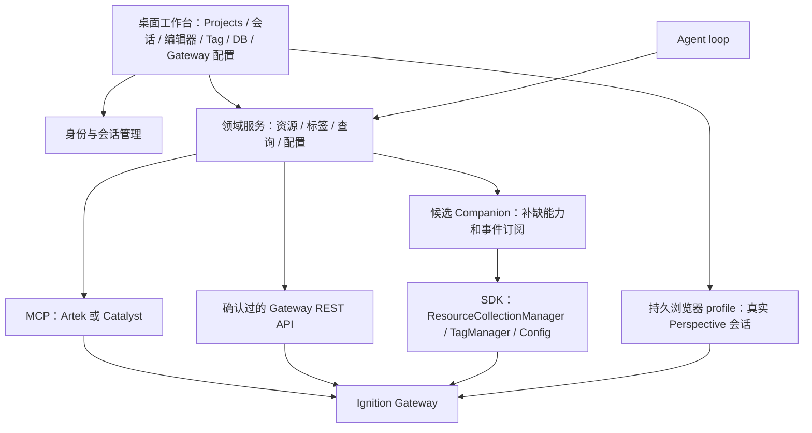

# 深入技术调查：完整工程工作台如何连接 Ignition

日期：2026-11-17。目标：回答 [REQ-01～REQ-10](product-requirements.md)，而不是重复产品宣传页。当前证据包括：实际下载的 **2027.2.0-beta1 SDK Javadoc**、固定 commit 的官方示例与 DeepSeek Harness 代码、Artek 工具手册、官方 MCP 配置截图。本文记录静态调查阶段；随后已完成真实 Gateway、MCP、Tag、View/脚本热更新及数据库实验，见 [运行验证报告](runtime-validation-2027-beta1.md)。

## 1. 本轮纠正的核心判断

1. 不能以“8.3 走 Artek，2027 走 Catalyst”两条 MCP 连接覆盖全部产品需求。MCP 工具调用、工程资源写入、实时数据订阅、用户登录和运行时预览是不同通道。
2. SDK 已提供服务器资源签名冲突检查；此前只建议客户端 hash 比较不够。若走自有 Gateway bridge，应使用平台自身的 push/pull 语义，而不是直接覆盖磁盘文件。
3. Artek-MCP 有明确的 View、脚本文件和 Gateway 配置写入工具，但 `tag_write` 写的是值，不能据此宣称已解决新建 Tag/UDT。
4. Artek-MCP 明确为无状态服务，MCP GET 返回 405，没有事件流。因此“连接到 MCP”不等于具备实时 Tag 订阅。
5. DeepSeek Harness 桌面浏览器现有分区是进程生命周期内的存储，重启不保留 cookie。这与用户要求的持久登录直接冲突，复用时必须改造。

这些结论分别由后文的制品、源码及供应商手册支持。关于“缺失”的结论只限定于已检查表面，不等于断言整个 Ignition 平台不存在相关能力。

## 2. 固定 Beta 版本的实际证据

### SDK 制品

从官方 Maven public 仓库实际下载并打开以下 Javadoc，而非仅通过搜索推测接口。三个制品均为 `com.inductiveautomation.ignition:<artifact>:2027.2.0-beta1:javadoc`。

| artifact | 实际字节数 | SHA-256 |
|---|---:|---|
| common | 19,992,657 | `467a3249fcd259c5538b1da92907406b5fb047cd1cd4c4c1fb7a7ef341482964` |
| gateway-api | 10,275,301 | `83466d37a0e15f1b85f59db834220c0851bcc59fdd0c57907a52ac60456bc2bb` |
| designer | 11,844,741 | `3d7bae057942aa7027e88d82adbf5d703e77086fc06e471be9e504d237ff1afe` |

[机器可读证据](evidence/2027.2.0-beta1-sdk.json) 记录原始下载 URL、归档内路径和 19 个重点类的公开签名。[采集脚本](../research/collect_sdk_evidence.py) 可重复下载和提取；不包含供应商实现源码或整个 Javadoc 的再分发。SHA 标识本次拿到的文件，不代替供应商签名验证。

官方 SDK 示例固定在 commit [`436cda89`](https://github.com/inductiveautomation/ignition-sdk-examples/tree/436cda89fbae09b4550ed1eeba189cc63a71d09e)。其 `project-resource/gradle/libs.versions.toml` 指定 Beta1 和 Java 25，`build.gradle.kts` 指定最低平台 `2027.2.0`。同目录 `docker-compose.yml` 却仍为 `8.1.26`，因此不可未经修改直接作为 Beta 测试环境。

另外查询了官方 Docker tag `inductiveautomation/ignition:2027.2.0-beta1` 的 manifest：存在 amd64 与 arm64 条目。amd64 manifest digest 为 `sha256:8893fd9065ebb48965fa249dadbd11d48bb4edbd2047272889d411c7ab4b76c9`。**只查询了 manifest，没有拉取并运行镜像。**

### 访问失败也要准确解释

SDK 的 `ignitionsdk:gateway-api` 是转向实际 `ignition:gateway-api` 的兼容 POM，不能从包装坐标猜 implementation 坐标。尝试的 `-sources.jar` 返回 401，随后从公开 `-javadoc.jar` 获取到了 API 文档。这表示所尝试源码制品未公开访问成功，不表示 SDK 不可用，也没有绕过认证。

旧下载页面的动态请求未拿到可用安装列表，故本轮不以它推断“没有 Beta 下载”；Docker manifest 和 SDK 制品已提供独立版本证据。

## 3. Catalyst 的内部能力到底在哪里

以下为 Javadoc 中真实存在的 Java 类/方法，**不是 MCP wire tool 名称**。

| 范围 | 已确认接口 | 含义 |
|---|---|---|
| AI 基础 | `AiContext.newAgenticHarness(...)` | Catalyst 内部本身就有 Harness API，不仅是一个模型配置表 |
| 会话 | `AgenticHarness.send / clearMemory / rewind / close` | 有持续对话对象；同一对象不能并发 send，拥有者负责释放 |
| 工具 | `CallableTool.getDescription / invoke / permissions / namespace` | 工具描述、执行与权限分开；工具可见性与执行都检查 actor |
| 身份 | `AiActor.isAuthorizedFor(...)` | 调用者身份显式传入，不是任意线程能获取的“当前用户” |
| Gateway AI | `GatewayAiContext.mcpToolsFor(...)` | 为 Gateway Agent 消费出站 MCP 工具；不能理解为自动对外发布所有 Java 方法 |
| Designer 工具 | `DesignerToolFactory` 的 8 个 bundle | 均在文档中描述为只读浏览，涵盖项目、标签配置、库、数据库 schema、OPC、Gateway 配置及编辑器状态 |
| 项目读取 | `DesignableProjectTools` | 浏览资源、读 metadata、读指定 data blob；构造时绑定内存中的 `DesignableProject` |
| 编辑建议应用 | `ReplyRenderer.renderSuggestion(...)` | 模型建议交给宿主呈现与应用；不是一次通用远程项目写入 |

因此 SDK 证据支持“Catalyst 已有领域上下文和宿主编辑辅助”，也支持“这些辅助并非天然就是无 Designer 的外部编辑服务”。仅将 `DesignerToolFactory` 接到 MCP，仍不能得到完整项目写入，而且它依赖 DesignerContext。

### MCP 内置工具：截图可证实到什么程度

实际查看了 [官方 Configure Primitives 截图](https://docs.inductiveautomation.com/assets/images/configure-primitives-panel-14ba3d6cce6be590ceb25358ac7d5bcd.png)：`ignition/tags` 展示 `realtime`、`query`、`providers`、`diagnostics`；还有项目自定义工具分组。它证实了标签读取/查询/诊断这一组内置能力。

**限制**：这是滚动手册中的截图，未证明截图与上述 Beta1 制品完全同 build；也未证明四项就是所有工具。显示名也不保证等于外部客户端协商后的 wire 名。当前没有 MCP 导出清单，因此本项目不伪造 Catalyst 的完整工具 schema，也不把截图里没出现的项目/Tag 写入功能断言为不存在。

## 4. 直接修改 Gateway：分成三套对象

### A. 项目资源：画面、脚本、Named Query 等

Beta SDK 的 `ProjectManager` 继承 `ResourceCollectionManager`。后者提供 `find/getResource/pull/push/pushPartial`，使用 `ChangeOperation`、快照与 `PushOperation`。

已确认的关键语义：

- 修改/删除带过期签名时，push 会报告冲突；调用者应重新 pull 后解决。
- push 返回时磁盘已更新，但监听器通知可能尚未完成；应等待返回 future，再进入“资源通知完成”状态。
- `pushPartial` 明确允许部分成功，并要求调用者保证操作之间独立。
- `requestScan()` 是扫描文件变化，不是原生资源 push 的替代名称。

**建议**自有 bridge 的写入走这些平台 API：保留未知 blob、attributes、scope、资源类型和所有权，带平台签名提交，再等待通知并读回。不能把 HTTP 200、已写盘、通知完成和 Perspective 新会话已看到更新合并成一个“完成”。

资源签名冲突校验比客户端 hash 更适合作为提交前提，但这些文档仍不足以证明跨项目、Tag、数据库和 Gateway 配置的全局事务；不能给它包装出一个不存在的事务承诺。

### B. Tag 配置与实时值

Beta SDK `TagProvider` 分别提供：

- 配置读取 `getTagConfigsAsync`，配置写入 `saveTagConfigsAsync`，以及删除配置、Tag Group 等接口。
- 实时值 `readAsync/writeAsync`，返回值/质量或逐项写结果。
- `TagManager.subscribeAsync/unsubscribeAsync` 负责值变化订阅。
- `GatewayTagManager.addTagStructureListener/removeTagStructureListener` 负责新增、删除、改名导致的树结构变化；不会自动给出初始树。

对应产品必须拆成“树快照 + 结构事件”“配置编辑”“值订阅”“值写入”四个能力。订阅值不会自动刷新树，新建 Tag 也不等于一次值写入。应使用带调用者 `SecurityContext` 的接口；便利重载存在空安全上下文，不能未经设计就选它实现用户会话。

脚本路径也有官方 [system.tag.configure](https://docs.inductiveautomation.com/docs/2027/appendix/scripting-functions/system-tag/system-tag-configure)，可封装成限定参数的 Catalyst 自定义工具。读取配置的 [getConfiguration](https://docs.inductiveautomation.com/docs/2027/appendix/scripting-functions/system-tag/system-tag-getConfiguration) 会省略默认属性，因此编辑器必须区分默认值、显式值和 UDT 继承值，不能把返回字典当成所有生效属性。

### C. Gateway 配置与数据库

Gateway 配置资源与项目资源不是同一命名空间。可以经实际 OpenAPI 及适配层处理，按 schema 展示字段、读回运行状态；热应用与需要重启必须分别显示。涉及遮蔽的 secret 时保留原值语义，不把掩码当作真实密码写回。

数据库浏览通过 Gateway 中已配置的 datasource 访问，包含连接状态、表/列 metadata、分页结果和 Named Query。浏览数据库不等于导出 JDBC 密码，也不应让 UI 另建一条身份不明的直连数据库连接。结构和查询结果使用独立刷新策略，不给每一行数据开 Tag 式订阅。后续已获取实际 Beta Gateway OpenAPI，并验证连接配置及项目脚本查询；接口和范围见[运行验证报告](runtime-validation-2027-beta1.md)。独立的通用 SQL/表结构浏览 RPC 仍待验证。

## 5. Artek 的真实覆盖与明确缺口

这次追到 [供应商工具手册](https://docs.artek.io/mcp/tools/)，而不只看首页工具数量：

| 用户任务 | 明确存在的工具 | 尚需补足的部分 |
|---|---|---|
| 项目浏览/读 | `projects_list`, `project_resources`, `project_resource_read` | 与用户项目授权、继承归属及分页关联 |
| 修改画面/脚本 | `project_resource_write`, `view_patch` | JSON 解析不等于组件语义、引用或脚本运行正确 |
| Gateway 配置 | `config_types/resources/resource_read/resource_write` | secret 掩码保留、应用/重启反馈、用户权限关联 |
| Tag 树和值 | `tag_browse`, `tag_read`, `tag_config_read`, `tag_write` | 工具表没有建立专用新建 Tag/UDT 的确认依据；`tag_write` 仅写值 |
| 比较/部署 | `deploy_diff`, `deploy_apply` | 超时是未确认状态，不等于失败并已回滚 |
| 运行时会话 | `list_perspective_sessions`, `get_session_details` | 这是监控，不是浏览器身份登录或渲染引擎 |

供应商说明 `project_resource_write` 校验 `.py` 与 `.json` 的语法，其他类型不一定校验；部署 zip 不做同样内容校验。继承资源写入会检查定义方；这需要反映到工作台，不能用 child 项目路径偷偷修改 parent。

[行为手册](https://docs.artek.io/mcp/behavior-notes/) 明确服务无状态、GET 405、无事件推送；工具或 profile 变化后要重连。由此能直接判定：**Artek MCP 本身不承担用户要求的 Tag 值实时推送与长期工程会话。**可用确定性批量轮询作为早期模式，但高频浏览应走 SDK 订阅桥。

[REST bridge 手册](https://docs.artek.io/mcp/rest-bridge/) 另有 `api_discover/api_call`，通过 loopback 和另外配置的 Gateway API key 调用 OpenAPI；`api_call` 连 GET 都按 mutating 管控。其 authority 是配置的 Gateway key，不自动等于当前登录用户。与前文一样，须先发现具体路由，不能把这个通用 bridge 当成已验证的全部工程 API。

[Artek-Designer 工具](https://docs.artek.io/designer/tools/) 能取得组件 schema、修改 View，并保持撤销语义，但要求用户的 Designer 打开且启用；用户保存前修改停留在 Designer。它适合做能力参照，**不满足本产品“直接改 Gateway、不回 Designer 保存”的最终路径**。

## 6. Project 登录与“长期 Session”应该如何理解

Designer 支持 Classic 与 IdP 两种登录策略，Project 不是一个独立认证服务器。[官方安全设置](https://docs.inductiveautomation.com/docs/2027/platform/security/gateway-general-security-settings) 及 [IdP 说明](https://docs.inductiveautomation.com/docs/2027/platform/security/identity-provider-authentication-strategy) 规定 token 生命周期与恢复行为。由此，用户要求能实现为持久登录体验，但不能承诺一个 token 永不过期，也不能借心跳绕过强制重新认证。

**建议的客户端模型**：

- `GatewayConnection`：地址、版本、信任配置、模块能力与传输状态。
- `EngineeringIdentity`：该 Gateway 下的用户身份、授权、刷新/失效状态。
- `ProjectWorkspace`：项目名、默认 Provider/datasource、资源快照、打开的资源和未提交变更。
- `PreviewProfile`：Gateway + 用户身份的浏览器持久分区，保存 cookie/storage；按项目关联运行会话。

添加项目仍出现用户要求的“选择 Gateway → 登录 → 选择有权限项目 → 加入左栏”流程。相同身份可以复用可验证的 Gateway 登录，身份不同则隔离，不因项目同名或地址相似共享凭据。

必须区分四种状态：工程身份有效、MCP 可调用、实时订阅在线、Perspective 已登录。一个绿灯不能覆盖全部。客户端持久化 credential 引用及浏览器分区，不把密码写入聊天历史。

**还没查实的关键问题**：是否存在可供本产品稳定调用的官方外部工程登录/续期接口。当前检查到的 SDK/手册不能据此证明第三方可直接复用 Designer 私有登录协议。所以建议路线不能写成“调用 Designer login API”然后略过。若需要自有 companion，必须实现真实受控的用户认证映射与项目权限校验；具体 API 在运行验证前仍未定，不用管理员 key 冒充完成这项需求。

## 7. DeepSeek 壳子：已查到能复用什么、必须改什么

代码与文档固定在 [`39163dd3`](https://github.com/deepseek-ai/deepseek-harness/tree/39163dd30f703a79079e2d2446545cff3c453738)，其仓库许可为 MIT。实际查看：`docs/architecture.md`、MCP client/manager、sidebar browser、desktop authentication 文档及 `apps/desktop/src/browser-guests.ts`。

可复用的部分：Electron 桌面壳、插件装配、聊天/模型、MCP 动态连接管理、右侧浏览器。其 MCP manager 有连接状态、重连和凭据引用；这让“专用 distribution + 领域插件”成为可研究路线，不必先重写全部聊天基础设施。

有两项不能直接照用：

1. [浏览器代码](https://github.com/deepseek-ai/deepseek-harness/blob/39163dd30f703a79079e2d2446545cff3c453738/apps/desktop/src/browser-guests.ts) 以 workspace 分配随机 partition，未使用 `persist:`。文档明确 cookie/storage 不跨应用重启保留。要改成按 Gateway + 工程身份建立持久 profile，并正确处理登出、失效与隔离。
2. [desktop authentication](https://github.com/deepseek-ai/deepseek-harness/blob/39163dd30f703a79079e2d2446545cff3c453738/packages/host/authentication-desktop/README.md) 是桌面与它自己 Host 之间的认证，不是 Ignition 用户登录。复用它不会自动获得 Gateway 权限。

因此当前建议比较两条实现：A. DSH 专用 distribution + Ignition 插件，少量改桌面 browser host；B. 独立 Electron 壳复用相同领域服务。用户要的是相似体验，并未要求必须 fork；应以持久登录、项目栏扩展、预览生命周期三项技术验证决定。此前直接偏向完全独立实现，证据不足，此处修正为优先评估 A。

## 8. 建议架构：协议适配之外还需工程层

**研究建议，非已批准设计**：保持双版本 MCP，但将完整产品能力定义在其上层。若目标 Gateway 已有的公开接口不足以提供身份映射、签名资源写入或实时事件，则增加轻量 companion；8.3 和 2027 分别构建，不能共用未经验证的 modl。MCP 做 AI 工具入口，实时显示走订阅/查询层，UI 手动操作与 AI 调用同一领域服务。

连接模式在 UI 明示能力：仅 MCP 可先浏览和执行现有工具；补齐认证/REST/bridge 后才承诺完整工程工作台。不能把有限模式宣称为已满足所有需求。

### 刷新闭环

- 项目资源：等待写入和平台通知 → 局部失效资源缓存 → 读回签名/内容 → 真实 Perspective 检查；避免每次改属性就丢弃预览登录并重开整个会话。
- Tag：先树快照，后结构通知；仅对可见/关注值订阅；批量合并更新，卸载面板时释放订阅。
- 数据库：分页请求、显式重跑和可配置自动刷新，结果带采集时间；查询失败不显示为“空表”。
- Gateway 配置：读回配置并观察连接/模块状态，单独呈现“已保存、已应用、需重启”。
- 断线：恢复身份 → 重建 transport → 重取快照 → 重新订阅。未确认写入先读回核对，不无条件重放。

## 9. 把验证落到用户的完整任务上

不再只验证修改标题。建议在隔离 Gateway 上以以下连续场景验收，所有结果都记录版本与身份：

1. 添加项目并登录，重启工作台后恢复；同一 Gateway 的第二个用户不能借用首个用户的预览状态。
2. 新建 Memory Tag、修改配置、修改实时值；Tag 树和 live inspector 自动更新；断线恢复后质量码/时间戳正确。
3. 新建 View，绑定该 Tag，加入组件脚本；直接写回 Gateway，Perspective 内置预览出现新画面并收到值变化。
4. 添加项目库脚本及 Gateway 事件脚本，确认不同宿主的资源标识和执行生命周期。
5. 修改一个可回退的 Gateway 配置，看到实际应用状态；打开数据库表和 Named Query，验证分页/刷新。
6. Designer 或另一个工作台同时修改资源，旧签名提交被拒绝；超时写入通过读回判定，不覆盖其他人的修改。

**本轮已完成的是静态接口与源码调查，不是以上运行验收。**剩余工作的阻塞已从“不了解接口”缩小为：Beta1 实际 MCP 清单、外部工程登录/续期协议、Companion 是否必要、跨两个目标版本的写入/刷新运行验证。这些问题未解决前，不应开始堆砌产品页面。

## 10. 运行验证进行中：补充的登录接口依据

新增检查的 Beta1 Javadoc 包括 `WebUiSession`、`WebUiSessionManager` 和 `RequestContext`，已加入制品证据。`WebUiSession` 提供 `getUserContext/getCsrfToken` 以及 `SESSION_ACCESS/SESSION_READ/SESSION_WRITE` 访问控制策略；`WebUiSessionManager.findSession(RequestContext)` 可以从请求找用户 Web 会话。

这使“复用 Gateway 交互登录并在扩展路由检查用户权限”有了具体 SDK 依据，但不证明它与 Designer 登录权限完全等价。运行测试应比较：无凭据、Web cookie、API token 对实际工程 API 和 MCP endpoint 的接受情况，并确认 CSRF 规则。若原生路由已足够，优先复用，避免先假定必须开发 companion。

当前正在准备隔离 Beta1 Gateway；本节不是运行通过记录。最终实测结果另行记录。
